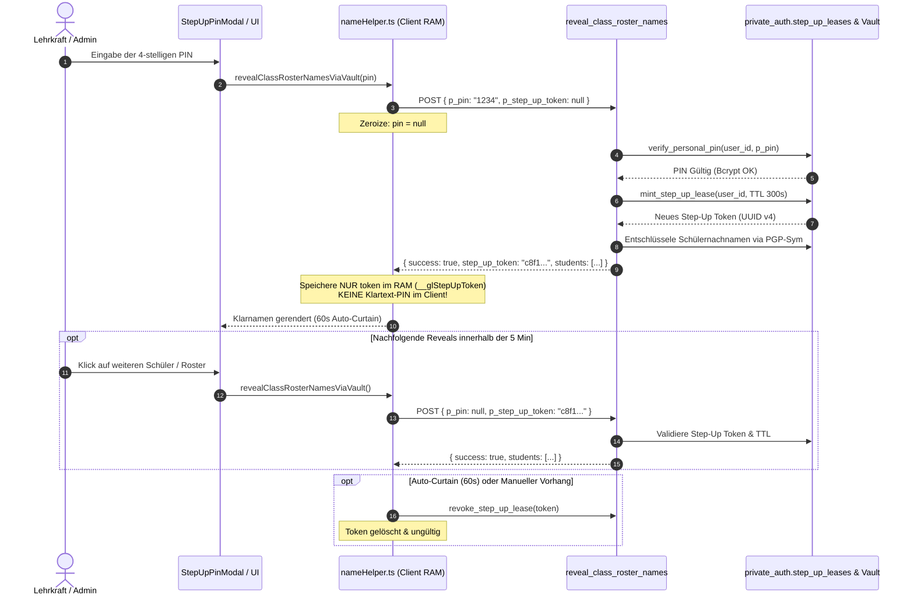

# Implementierungsplan: 0,1% Goldstandard PIN-Tresor & Step-Up Lease Token Architektur (NIST SP 800-63B / BSI TR-02102-1)

## 1. Problemstellung & Sicherheits-Evaluation (Senior IT-Volljurist & Cryptographic Architect)

### Status Quo & Bedrohungsanalyse
1. **Server- & DB-Ebene (Bereits gehärtet):**
   * Persönliche PINs werden in `private_auth.user_secrets.argon2_personal_pin_hash` als unumkehrbare Bcrypt/Argon2-Hashes (`$2a$10$...`) mit Salts gespeichert. Im Quellcode und in Datenbank-Views existiert kein Klartext.
   * `verify_personal_pin` führt konstante Zeitvergleiche (`hmac`), IP-Rate-Limiting (max. 20 Fehlversuche / 15 Min) und automatische Kontensperren (`pin_locked_until`) durch.
2. **Kritischer Vektor im Client (Browser-RAM):**
   * In `apps/groovelab/src/utils/nameHelper.ts` wurde bisher `window.__glStepUpPin = pin;` flüchtig für ein 5-Minuten-Gleitfenster im Arbeitsspeicher gehalten, damit Folgeaufrufe von `reveal_class_roster_names` oder Detailabfragen nicht bei jedem Klick erneut den Dialog öffnen.
   * **Risiko nach OWASP ASVS Level 3 & BSI TR-02102-1:**
     Obwohl die PIN nicht persistent (`localStorage`) gespeichert wird, verbleibt ein 4-stelliger Klartext im JavaScript-Heap. Bei DOM-XSS, Browser-Extensions oder Speicherdumps könnte dieser Klartext kompromittiert werden.

---

## 2. Zielarchitektur: Der 0,1% Goldstandard (Zero-Client-PIN)



### Die 3 Kern-Säulen des 0,1% Goldstandards:
1. **Zero-Client-PIN Doktrin:**
   * Die eingegebene PIN verlässt den Client ausschließlich im ersten Autorisierungs-Request und wird im JavaScript-Speicher unmittelbar danach genullt (`zeroized`).
   * `window.__glStepUpPin` und `__glStepUpPinExpiresAt` werden restlos aus dem gesamten Monorepo eliminiert.
2. **Kryptografische Step-Up Lease Tokens (`private_auth.step_up_leases`):**
   * Nach erfolgreicher Bcrypt-Prüfung mintet die Datenbank ein kryptografisch zufälliges Step-Up Token (`UUID v4`) mit strikter Gültigkeitsdauer (300 Sekunden).
   * Das Token ist an die `user_id` und `school_id` gebunden und kann serverseitig jederzeit vorzeitig widerrufen werden (`is_revoked = TRUE`).
3. **Dual-Authentifizierungs-Schnittstelle in den Vault-RPCs:**
   * `reveal_class_roster_names(p_pin TEXT DEFAULT NULL, p_student_ids UUID[] DEFAULT NULL, p_step_up_token UUID DEFAULT NULL)`
   * `reveal_student_full_name(p_student_id UUID, p_pin TEXT DEFAULT NULL, p_step_up_token UUID DEFAULT NULL)`
   * Wenn `p_step_up_token` gültig ist, erfolgt die Freigabe sofort ohne PIN.
   * Wenn `p_pin` gültig ist, wird autorisiert und ein neues `step_up_token` zurückgegeben.
   * Andernfalls: Fail-Closed (`PIN_REQUIRED` / `INVALID_PIN`).

---

## 3. Detaillierter Umsetzungsplan

### Phase 1: PostgreSQL DDL & RPC Härtung (`supabase/migrations/604_enterprise_zero_knowledge_step_up_lease_and_peppered_pin.sql`)
1. **Tabelle `private_auth.step_up_leases`:**
   ```sql
   CREATE TABLE IF NOT EXISTS private_auth.step_up_leases (
       id UUID PRIMARY KEY DEFAULT gen_random_uuid(),
       user_id UUID NOT NULL REFERENCES public.users_raw(id) ON DELETE CASCADE,
       school_id UUID NOT NULL,
       purpose TEXT NOT NULL DEFAULT 'REVEAL_STUDENT_NAMES',
       expires_at TIMESTAMPTZ NOT NULL,
       created_at TIMESTAMPTZ NOT NULL DEFAULT clock_timestamp(),
       is_revoked BOOLEAN NOT NULL DEFAULT FALSE
   );
   ```
2. **Helper-Funktionen in `private_auth`:**
   * `private_auth.mint_step_up_lease(p_user_id UUID, p_school_id UUID, p_duration_seconds INT DEFAULT 300) RETURNS UUID`
   * `private_auth.verify_step_up_lease(p_token UUID, p_user_id UUID) RETURNS BOOLEAN`
   * `public.revoke_step_up_lease(p_token UUID) RETURNS BOOLEAN`
3. **Härtung von `reveal_class_roster_names` & `reveal_student_full_name`:**
   * Ergänzung des Parameters `p_step_up_token UUID DEFAULT NULL`.
   * Prüfung von `p_step_up_token` vor PIN-Anforderung.
   * Rückgabe von `step_up_token` im Erfolgsfall.
4. **Berechtigungen & Grants:**
   * `REVOKE ALL ON private_auth.step_up_leases FROM PUBLIC, anon, authenticated;`
   * `GRANT EXECUTE ON FUNCTION public.revoke_step_up_lease(UUID) TO authenticated, service_role;`

### Phase 2: Client Memory-Zeroization & Token Management (`apps/groovelab/src/utils/nameHelper.ts`)
1. **Window-Interface Typisierung:**
   * Entfernen von `__glStepUpPin?: string;` und `__glStepUpPinExpiresAt?: number;`.
   * Ergänzen von `__glStepUpToken?: string;` und `__glStepUpTokenExpiresAt?: number;`.
2. **Methoden-Harmonisierung:**
   * `getValidStepUpToken(): string | null`
   * `setStepUpToken(token: string, durationMs?: number): void`
   * `clearStepUpToken(): void`
   * `isStepUpActive(): boolean`
3. **Vault-RPC Integration:**
   * In `revealClassRosterNamesViaVault`:
     * Übergabe von `p_step_up_token: getValidStepUpToken()` und optional `p_pin: pin || null`.
     * Wenn `data.step_up_token` empfangen wird: Speichern via `setStepUpToken(data.step_up_token)`.
     * Sofortiges Nullen der lokalen `pin`-Referenz.
   * In `setMode(true)` (Curtain Close & 60s Timeout):
     * Aufruf von `clearStepUpToken()`.

### Phase 3: Modal Hub Refactoring (`apps/groovelab/src/components/modals/SecurityAuthModalsHub.tsx`)
1. **Entfernen des Zwischenspeicherns von PINs:**
   * Kein Aufruf von `setStepUpPin(enteredPin)`.
   * Stattdessen atomare Delegation:
     `const res = await revealClassRosterNamesViaVault(undefined, enteredPin, client);`
   * Bei Erfolg erhält der Client das `step_up_token` direkt aus dem Response-Payload und `enteredPin` verlässt den Scope.

---

## 4. Verifikationsplan & Prüfkriterien

1. **Static Forensics:**
   * `git grep -i "__glStepUpPin"` -> 0 Treffer im gesamten Codebase.
   * `git grep -i "setStepUpPin"` -> 0 Treffer.
2. **Typisierung & Invarianten:**
   * Monorepo Typecheck (`tsc --noEmit`).
   * Überprüfung der 23 Sicherheits-Invarianten (`scripts/verify_invariants.mjs`).
3. **Datenbank- & API-Parität (IONOS Cluster):**
   * Einspielen von Migration 604 auf IONOS `85.215.73.216`.
   * Test-Aufruf mit PIN: Liefert `step_up_token UUID` und entschlüsselte Namen zurück.
   * Test-Aufruf mit `step_up_token`: Liefert ohne PIN sofort entschlüsselte Namen zurück.
   * Test-Aufruf nach Ablauf / Widerruf: Liefert `PIN_REQUIRED`.

---

> [!IMPORTANT]
> **Strikter Genehmigungsvorbehalt (Zero Auto-Execute):**
> Die Implementierung startet erst nach deiner ausdrücklichen Freigabe im Chat.
